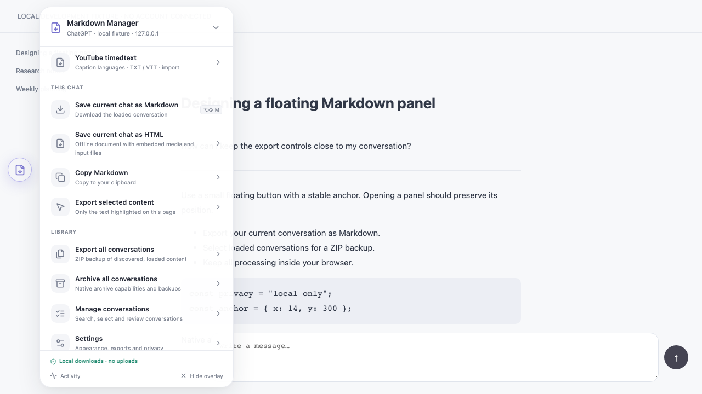
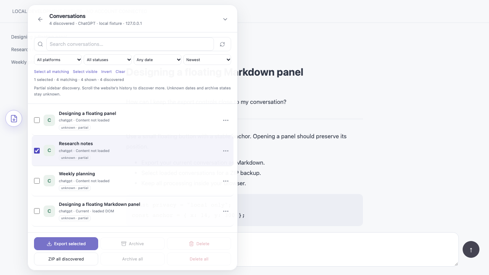

# AI Chat Markdown Manager v2.4.9

[Русский](README.ru.md) · [Build and install](#17-build)

## 1. Overview

A local userscript for turning AI conversations into Markdown, automatically loading selected chats for ZIP backups, and downloading YouTube captions as TXT/VTT. A floating React interface runs inside a Shadow DOM. No server, account connection, telemetry, or CDN is required.

v2.4.0 adds HTML/Markdown ZIPs with separate offline images, media and input/reference files, editable filenames, a styled format selector and export progress. Loaded SVG diagrams are captured as PNG, fixing the false unavailable-attachment error in ChatGPT.

This release preserves the v1.2.0 converter and all 48 domain/path match rules, adding 3 targeted YouTube rules. Discovery is partial. ChatGPT batch archive/delete and Gemini batch delete use recognized native controls with mandatory confirmation and verified outcomes.

## 2. Screenshots and UI preview




[Mobile WebKit preview](docs/screenshots/mobile.png). These images show the actual production bundle on a clearly labelled local fixture, not a connected account. The Base44 reference informed composition; see [observed design and inspection limits](docs/DESIGN_INVENTORY.md).

## 3. Features

- Draggable FAB, separate persistent anchor, Send-button avoidance, minimize and restore.
- Dashboard/tools, conversations, export, archive information, settings and activity screens.
- Search, stable multi-selection, filters, sorting, automatic scroll loading in groups of 24, preview and context actions.
- Markdown downloads, clipboard, highlighted-text export, genuine in-tab snapshots and ZIP manifests.
- YouTube video-page caption detection, language/translation selection and direct TXT/VTT downloads.
- ChatGPT batch archive/delete, Gemini delete, reviewed-backup shortcuts and mandatory confirmations.
- Sequential batches, cancellation, per-item failures, reports and export-only safe retries.
- Light/dark/system themes, English/Russian interface and reduced motion.

## 4. Platforms and capabilities

| Platform | Discovery | Markdown / ZIP input | Native archive | Native delete |
| --- | --- | --- | --- | --- |
| ChatGPT | Sidebar `/c/id` + current page | Automatic native chat loading / in-tab snapshots | Conditional native support | Conditional native support |
| Gemini | Sidebar `/app/id` + current page | Automatic native chat loading / in-tab snapshots | Unsupported | Conditional native support |
| Claude | Sidebar `/chat/id` + current page | Automatic native chat loading / in-tab snapshots | Unsupported | Unsupported |
| DeepSeek | Links `/a/chat/s/id` + current page | Loaded DOM / explicit in-tab snapshots | Unsupported | Unsupported |
| Other inherited matches | Current page only | Generic loaded DOM / in-tab snapshots | Unsupported | Unsupported |

Current-chat downloads were verified in authenticated Safari sessions on ChatGPT, Gemini, Grok, Claude and DeepSeek. Chromium/WebKit fixtures cover the broader export matrix; native mutations have not been tested on a signed-in account. Every inherited domain and its verification status is in [PLATFORMS.md](docs/PLATFORMS.md).

## 5. Safari installation

Install [Userscripts](https://github.com/quoid/userscripts), enable it in Safari extension settings, and allow the intended chat website. Open the scripts directory configured in the Userscripts app and copy `dist/AI-Chat-Markdown-Manager.user.js` there. Enable the script, disable the old version and reload the site. See [complete Safari steps and troubleshooting](docs/INSTALL-SAFARI.md).

## 6. Tampermonkey installation

Install [Tampermonkey](https://www.tampermonkey.net/), open its dashboard and create a new script. Replace the template with the complete distributable, save, enable it and reload a matching website. Disable duplicate versions. [Installation and upgrade guide](docs/INSTALL-TAMPERMONKEY.md).

Enable **Save media as separate files (ZIP)** for a document plus an `assets/` directory. Blob images and loaded SVG diagrams become PNG files; accessible input/reference files retain their bytes. Edit **Filename** before downloading. Unpack the whole ZIP and keep its folders together; HTML/Markdown links resolve locally. External citations still require internet. The same option works in preview, settings and batch backups.

## 7. Quick start

1. Open a conversation and let its messages load.
2. Click the floating file icon. Drag it to a convenient position.
3. Build first with `npm ci` and `npm run build`; generated installation files are kept locally.

Choose **Save Current Chat** to download or **Copy Markdown** to copy to the clipboard. Use the expand button to fill the browser viewport. The X or Escape closes the manager.
4. Open **Manage conversations**. Scroll the website's own history to discover more entries.
5. Select chats and choose an export action. Read Activity for individual failures.

## 8. Markdown export

The inherited converter handles headings, lists, tables, fenced code with language tags, mathematical annotations, links and image references. Export Settings controls front matter, title, source URL, available timestamps, outline, images, links and filenames. Code fencing is always preserved.

Use **Export selected content** after highlighting webpage text, or Shift-click Save. Empty selections and empty content produce errors. Exports always warn when completeness is partial. Unknown timestamps are omitted, and filenames use `undated`; no dates or account history are invented.

Gemini uploaded images and generated image previews inside message buttons are included when **Image references** is enabled. File cards use exposed HTTP(S) download links when **Keep links** is enabled. In linked Markdown, attachments without reusable URLs keep their names with a “direct link unavailable” note. These options cover current-chat and batch exports, including image-only replies.

Choose **Save Current Chat** to set the format, filename and media options before capture. **Embed media and input files** puts enabled images, audio/video and input files inside the document. HTML enables embedding by default and includes its own styles. **Save ZIP with separate media and input files** stores the document and its assets together in an archive. Extract the whole ZIP before opening the document. With both switches off, resource links may require internet and can expire. Keep **Include images** and **Include links and input files** enabled to capture all supported resources.

Search either format for a filename such as `147-User attachment.png` to find it next to the image or attachment. In HTML, use the sticky **Table of contents** to jump to a message or heading. Browsers with CSS scroll timeline support show reading progress across the top.

In **Manage conversations → ⋯ beside a chat → Preview / export**, choose **File format** (Markdown or HTML), **Embed media and input files**, **Include images**, and **Include links and input files**. Each change refreshes the preview; use **Download Markdown** or **Download HTML** when ready. Failed refreshes disable download until corrected or retried. Preview choices apply to that preview only.

Embedded Markdown stores binary resources as base64 data URLs. Use a Markdown viewer that supports data images and download links. Offline exports try the bytes of a loaded image blob first. When that URL is unavailable, the exporter can save the displayed pixels at the exposed preview resolution.

Capture while online. Requests use the browser session and URLs exposed by the loaded conversation. CORS/CSP, expired links, missing file URLs, streaming-only media and unsupported image formats can block capture. A bulk ZIP with separate files keeps the transcript and readable assets when an image fails. The export report flags that chat for retry and excludes it from cleanup. Required backups must succeed for every target before native actions start.

The **64 MiB/chat and 100-resource limits** apply to inline embedding. With **Save ZIP with separate media and input files**, the archive can exceed both limits. On ChatGPT, the exporter scrolls through the conversation and captures images as their turns load. If older messages stop loading, the ZIP preserves the messages and media it could reach and marks the document incomplete. Keep the original chat and retry from Activity for bulk exports. If the browser cannot open a writable temporary file, save each prompted ZIP part and extract all parts into the same folder. The **20 MiB/file** limit and canvas preview bounds still apply. Review the files before deleting.

## 9. Selecting conversations

Checkboxes use platform + stable conversation ID. Search, sorting and filters never substitute row positions for identity. **Select visible** targets the displayed page; **Select all matching** includes all discovered matches. Invert affects matching entries; Clear removes the whole selection.

Selection persists on this website. Unknown dates/statuses remain unknown and do not match dated or active/archived filters. Scrolling near the list bottom automatically reveals 24 more rows; no Load more click is needed. Discovery accumulates sidebar IDs as the host virtualizes them; it cannot discover inaccessible account history.

## 10. Bulk export

Open **Export selected** for the checked chats or **Export All** for all discovered chats. Both dialogs show **File format** (HTML or Markdown), **Save ZIP with separate media and input files**, **Embed media and input files**, **Include images**, and **Include links and input files** above **Download ZIP**.

Bulk exports start with embedding on unless your settings already select separate files. Use the separate-files switch to write an asset folder per chat. Turning on either media switch turns off the other. Turn both off to keep external references.

On **ChatGPT, Gemini and Claude**, the manager opens each selected chat through its native sidebar link, waits for newly loaded messages and exports automatically. You do not need to open every chat first. The starting conversation is restored after completion or cancellation. Loading chats may mark them read.

Native SPA links must remain available. A missing/virtualized link, full-page reload or load timeout produces an individual failure; stale messages are never substituted. Scroll the platform sidebar and rescan if necessary. Other platforms still require current content or a matching temporary snapshot. Discovery and loaded history remain partial.

The ZIP contains successful `.md` or `.html` files and an optional `manifest.json` with per-item results. A fully failed batch produces a report, not an empty successful backup. Preview/export caches up to 20 chats / approximately 8 MiB in memory; reload clears it. Image/link/outline options must match cached content; the three automatic adapters reload when necessary.

Cancel stops queued work and preserves completed results. **Retry failed exports** opens the options again with the last confirmed choices. Filenames are sanitized and collisions receive numeric suffixes.

## YouTube captions

1. Install the current release, allow YouTube in your userscript extension and reload the video page.
2. Open the floating menu → **YouTube timedtext**. Available caption languages are detected automatically from the current video; switching videos refreshes them.
3. Choose an original track or an offered translation, then **Download TXT** or **Download VTT**. The script fetches and converts captions directly. No timedtext file needs to be downloaded or imported first.

TXT contains plain caption text; VTT retains timestamps. Captions must be available and accessible on that video. Empty/blocked responses produce a visible error, not an empty download. **Import saved timedtext (optional)** accepts JSON3, XML or VTT as a fallback. Signed caption URL parameters are used in memory only; no API key or transcript upload is needed.


## 11. Batch archive in ChatGPT

Reload after installing v2.4.3. Open **Manage conversations**, select chats and choose **Archive**, or **Archive all** for all discovered chats. Review the exact titles/IDs and confirm. ChatGPT's native menu archives each chat sequentially; a ZIP alone does not change its platform state. Restore archives through ChatGPT **Settings → Data controls → Archived chats → Manage**. [Official instructions](https://help.openai.com/en/articles/8809935-deleting-and-archiving-chats-in-chatgpt).

## 12. Batch delete and successful backups

ChatGPT and Gemini support **Delete** for selected chats and **Delete all** for the frozen discovered list. Review the targets, type `DELETE` or `DELETE ALL`, then confirm. Deletion cannot be undone. The manager uses each conversation's native controls and never clicks account-wide Settings deletion.

After a ZIP download, expand **Review backed-up chats** in Activity. Open the ZIP and inspect the files, then check **I opened the ZIP and checked these files**. Choose **Archive backed-up chats** (ChatGPT) or **Delete backed-up chats** (ChatGPT/Gemini). Only successful exports are included; the same confirmations apply. Message history can still be partial. Export never starts deletion automatically.

Native welcome/start pages, including Gemini `/app` (“Where should we start?”), are excluded. Reload after upgrading to remove old synthetic entries. Work/school accounts may restrict Gemini deletion. [Google instructions](https://support.google.com/gemini/answer/13666746).

## 13. Safety and confirmation

Native actions enable only when recognized sidebar action controls are available. Every job rechecks its exact same-origin ID, row and menu; Delete also requires a unique title-bearing native confirmation. Missing, ambiguous or changed controls fail explicitly. [Native checks and verification limits](docs/PLATFORMS.md#native-mutation-checks).

Only one sequential batch runs at a time. Optional required backup must export every frozen target and initiate ZIP download before mutation; the starting route is restored first. Cancel stops remaining jobs. An already clicked native action finishes bounded outcome observation: verified success remains success; an uncertain result fails and requires inspecting the website before retrying. No automatic native-action retry exists. Successful targets disappear from the manager until reload; reload after restoring a chat externally.

## 14. Keyboard shortcuts

| Action | Shortcut |
| --- | --- |
| Toggle / restore overlay | Alt+Shift+E |
| Save current Markdown | Alt+Shift+M |
| Export highlighted text | Shift-click Save |
| Minimize panel / close dialog | Escape |

Shortcuts can be disabled in Settings. If the overlay is hidden while shortcuts are disabled, reload the page. Browser or OS shortcuts may take precedence.

## 15. Settings

Appearance: theme, scale, opacity, language, reduced motion. FAB: size, drag lock, auto-minimize and shortcuts; drag to set its stored position or reset preferences. Markdown: metadata, source, title, timestamps when available, images, links, outline, highlighted-text mode, manifest and filename template.

Filename tokens: `{platform}`, `{date}`, `{slug}`, `{id}`. Bulk settings include batch size (sequential items per delay), delay, stop-on-error, archive/delete backup and local activity history. Mandatory confirmations stay enabled. Reset clears manager preferences, selection, anchor and count-only history on this origin.

## 16. Local development

Use Node.js 22.12+ and npm (verified here with Node 26.8.2 / npm 11.19.1).

```sh
npm ci
npm run dev
```

Open the printed localhost URL. The demonstration is explicitly a local fixture with no account connected. Development code is never required by the distributable. Do not test native deletion on a personal account.

## 17. Build

```sh
npm run build
```

Strict type checking precedes a production IIFE build. Run `npm run build` to generate `dist/AI-Chat-Markdown-Manager.user.js`, the root release ZIP and versioned `SHA256SUMS` file. The userscript, versioned ZIPs and checksum files are local build artifacts ignored by Git. Code, styles, React, Lucide, Marked and fflate are bundled locally. There are no runtime imports, remote dependencies or source maps. [Architecture](docs/ARCHITECTURE.md).

## 18. Tests

```sh
npm run lint
npm run typecheck
npm test
npx playwright install chromium webkit
npm run build
npm run test:integration
```

122 unit tests cover conversion, storage, identity, batching, Gemini safety, navigation and timedtext. 174 browser checks cover the production bundle in Chromium, desktop WebKit and mobile WebKit, including native batch actions, backup/review gates, offline image recovery, three-platform batch loading/restoration, cancellation, automatic caption languages, TXT/VTT downloads, XML fallback and video changes. The idle manager makes no outgoing requests. Explicit embedded-media and caption actions, native navigation and native archive/delete use the host site. WebKit automation is distinct from testing Safari's Userscripts extension. [Exact verification scope](docs/VERIFICATION.md).

## 19. Troubleshooting

| Symptom | What to do |
| --- | --- |
| No floating icon | Check extension/site permission, script enabled, URL matches; reload, then Alt+Shift+E |
| Two overlays / repeated downloads | Disable inherited or duplicate scripts in every script manager |
| Chat missing from list | Open/scroll the platform sidebar; Rescan; discovery is partial |
| Unloaded-content error | Reveal its native sidebar link and rescan/retry; other platforms require a manual visit |
| Formatting-changed error | Re-export that chat with current image/link/outline settings |
| Clipboard blocked | Use Save; browser permission or security context may prevent copying |
| Preferences lost | Private mode/storage restrictions may block per-origin localStorage |
| Delete/archive disabled | Open the native sidebar and rescan; missing controls or unsupported adapters keep actions unavailable |

Download confirmation, destination and retention are controlled by your browser. If the platform changes its DOM, use the platform manually and report a redacted reproduction.

## 20. Security and privacy

The script reads rendered conversation content, sidebar titles, IDs and URLs; it does not access private APIs or authentication cookies. YouTube signed caption URLs are read from public player data and used temporarily for caption requests, never persisted. Preferences, anchor and selection IDs are stored in the current site's localStorage. History stores counts/state/time only. Explicit Markdown/media snapshots remain in tab memory; embedding requests may send browser-managed session credentials to the exposed resource host; downloads contain conversation text and optional source URLs.

No conversation uploads or telemetry are implemented. Same-origin website scripts can read localStorage and the open Shadow DOM; this UI is style isolation, not a security boundary. Review exported reports before sharing because they contain IDs/errors. [Privacy details](docs/PRIVACY.md) · [Security reporting](SECURITY.md).

## 21. Known limitations

- Loaded DOM and discovered entries can be incomplete, stale or virtualized; statuses/dates are unknown unless verified.
- Generic fallback can include surrounding webpage text and cannot infer every platform's speaker roles.
- Automatic chat loading requires native SPA links and does not guarantee complete account history. Snapshots stay within tab/memory limits.
- YouTube captions/translations depend on video availability, signed URLs, site restrictions and browser permissions.
- Native actions depend on recognized current website controls. Deletion is irreversible; ChatGPT archives restore through its settings.
- Live Safari current-chat downloads are verified on five providers; live bulk cleanup, Tampermonkey and real touch hardware remain unverified.
- Modern CSS/ES2022 and an enabled userscript extension are required; host CSP, downloads and permissions may differ.
- Some technical errors and accessible control labels remain English in the Russian interface.

## 22. Contributing

Read the six compact project-memory documents before editing. Keep changes focused, preserve the converter and add realistic redacted fixtures for adapters. Native capabilities need identity safeguards, runtime checks and realistic regression fixtures. Record authenticated manual evidence separately when actually obtained. Follow [CONTRIBUTING.md](CONTRIBUTING.md).

## 23. Dual licensing

New original project code is **MIT OR Apache-2.0**, at your choice: [LICENSE](LICENSE), [MIT](LICENSE-MIT), [Apache 2.0](LICENSE-APACHE). `SPDX-License-Identifier: MIT OR Apache-2.0`.

The inherited converter remains MIT, copyright Adem Kouki. React, Lucide, Tailwind and fflate keep their respective licenses. The dual-license choice does not relicense third-party code. Complete attribution is in [THIRD-PARTY-NOTICES.md](THIRD-PARTY-NOTICES.md) and the release bundle. Original v1.2.0 source and README.txt remain as provenance.
