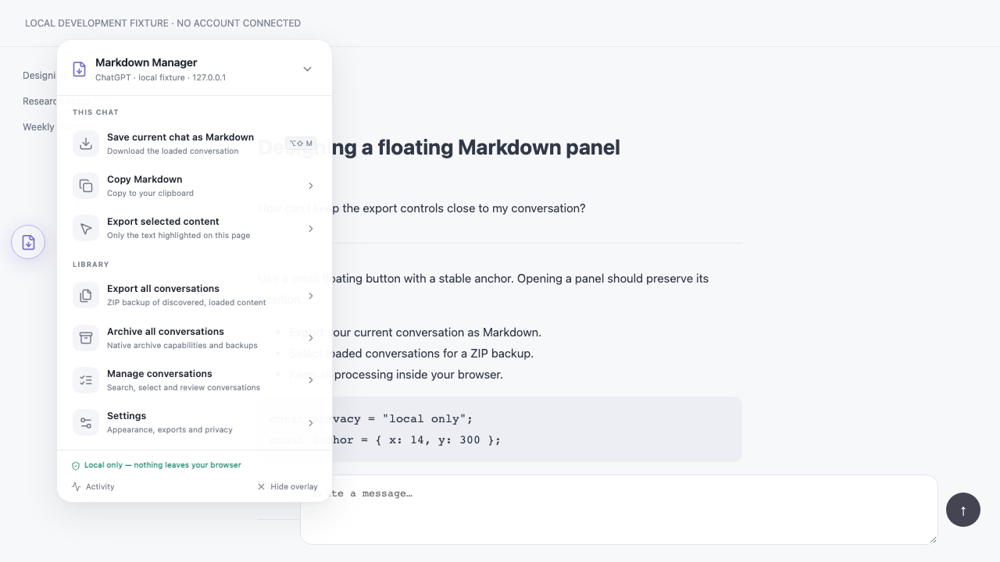
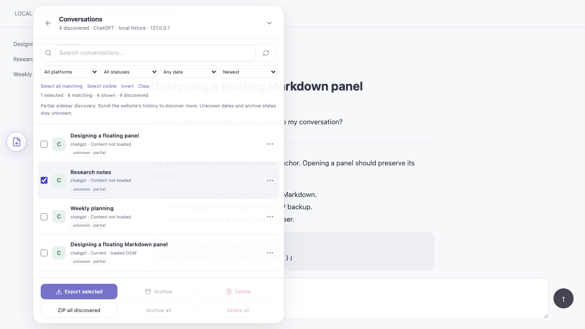

# AI Chat Markdown Manager v2.0

[English](README.md) · [Установочный скрипт](dist/AI-Chat-Markdown-Manager.user.js) · [ZIP релиза](AI-Chat-Markdown-Manager-v2.0.0.zip)

## 1. Обзор

Локальный userscript для сохранения загруженных ИИ-диалогов в Markdown, выбора обнаруженных чатов и создания ZIP-копий. Плавающий интерфейс React работает в Shadow DOM. Сервер, подключение аккаунта, телеметрия и CDN не требуются.

Сохранены конвертер v1.2.0 и все 48 правил доменов/путей. Обнаружение частичное. Нативное архивирование недоступно; удаление Gemini отключено до проверки в авторизованной сессии.

## 2. Скриншоты и интерфейс




[Мобильный WebKit](docs/screenshots/mobile.png). Снимки показывают настоящий production bundle на явно обозначенной локальной тестовой странице без подключения аккаунта. Композиция основана на Base44; [наблюдения и ограничения инспекции](docs/DESIGN_INVENTORY.md).

## 3. Возможности

- Перетаскиваемая кнопка FAB, отдельная сохранённая позиция, обход кнопки Send, сворачивание и восстановление.
- Главное меню, диалоги, экспорт, информация об архивировании, настройки и история операций.
- Поиск, устойчивый множественный выбор, фильтры, сортировка, страницы по 24 строки, предпросмотр и контекстные действия.
- Markdown, буфер обмена, выделенный текст, реальные временные снимки чатов и ZIP с манифестом.
- Последовательные пакеты, отмена, ошибки по каждому элементу, отчёты и безопасный повтор экспорта.
- Светлая/тёмная/системная тема, русский/английский интерфейс и уменьшенная анимация.

## 4. Платформы и возможности

| Платформа | Обнаружение | Источник Markdown / ZIP | Нативный архив | Нативное удаление |
| --- | --- | --- | --- | --- |
| ChatGPT | Боковая панель `/c/id` и текущая страница | Загруженный DOM / явные снимки в этой вкладке | Не поддерживается | Не поддерживается |
| Gemini | Боковая панель `/app/id` и текущая страница | Загруженный DOM / явные снимки в этой вкладке | Не поддерживается | Неизвестно; отключено |
| Claude | Боковая панель `/chat/id` и текущая страница | Загруженный DOM / явные снимки в этой вкладке | Не поддерживается | Не поддерживается |
| DeepSeek | Ссылки `/a/chat/s/id` и текущая страница | Загруженный DOM / явные снимки в этой вкладке | Не поддерживается | Не поддерживается |
| Остальные унаследованные домены | Только текущая страница | Общий DOM / снимки в этой вкладке | Не поддерживается | Не поддерживается |

Это возможности реализации, а не подтверждение проверки авторизованных аккаунтов. Bundle проверен на фикстурах Chromium/WebKit; Gemini был доступен только без входа. Все домены и статус проверки перечислены в [PLATFORMS.md](docs/PLATFORMS.md).

## 5. Установка в Safari

Установите [Userscripts](https://github.com/quoid/userscripts), включите расширение в настройках Safari и разрешите нужный сайт. Откройте папку скриптов, настроенную в приложении Userscripts, и скопируйте туда `dist/AI-Chat-Markdown-Manager.user.js`. Включите скрипт, отключите предыдущую версию и перезагрузите сайт. [Подробная инструкция](docs/INSTALL-SAFARI.md).

## 6. Установка в Tampermonkey

Установите [Tampermonkey](https://www.tampermonkey.net/), откройте панель управления и создайте новый скрипт. Замените шаблон полным содержимым дистрибутива, сохраните, включите и перезагрузите подходящий сайт. Отключите дубликаты. [Установка и обновление](docs/INSTALL-TAMPERMONKEY.md).

## 7. Быстрый старт

1. Откройте диалог и дождитесь загрузки сообщений.
2. Нажмите плавающую кнопку с иконкой файла. Перетащите её в удобное место.
3. Выберите сохранение текущего чата в Markdown или копирование Markdown.
4. Откройте управление диалогами. Прокручивайте историю самого сайта для обнаружения новых записей.
5. Выберите чаты и запустите экспорт. Индивидуальные ошибки смотрите в разделе операций.

## 8. Экспорт Markdown

Унаследованный конвертер обрабатывает заголовки, списки, таблицы, блоки кода с языком, математические аннотации, ссылки и ссылки на изображения. В настройках экспорта доступны front matter, заголовок, URL источника, известные даты, оглавление, изображения, ссылки и имена файлов. Блоки кода всегда сохраняются.

Для выделенного текста используйте соответствующее действие или Shift-клик по сохранению. Пустое выделение и пустой документ вызывают ошибку. Частичный экспорт содержит предупреждение. Неизвестные даты пропускаются; в имени файла используется `undated`. История и даты не выдумываются.

Изображения сохраняются как URL, а не скачиваются. Просмотрщик Markdown может впоследствии обратиться к этим адресам.

## 9. Выбор диалогов

Флажки используют пару платформа + стабильный ID диалога. Поиск, сортировка и фильтры не заменяют идентичность номером строки. «Выбрать видимые» действует на показанную страницу, «Выбрать найденные» — на все обнаруженные совпадения. Инверсия применяется к совпадениям; очистка снимает весь выбор.

Выбор сохраняется на текущем сайте. Неизвестные даты/статусы не попадают в фильтры по дате или активному/архивному состоянию. «Загрузить ещё» добавляет 24 строки. Обнаружение накапливает ID при виртуализации истории сайта, но не открывает недоступную историю аккаунта.

## 10. Пакетный экспорт

Сначала экспортируйте каждый нужный диалог, когда его содержимое загружено. Переходите между чатами **в той же вкладке без полной перезагрузки**. Явный экспорт сохраняет временный снимок Markdown: максимум 20 чатов и примерно 8 МиБ текста; старые снимки вытесняются. Другая вкладка и перезагрузка снимки не сохраняют.

Экспортируйте выбранные записи или все обнаруженные в ZIP. Архив содержит успешно созданные `.md` и необязательный `manifest.json` со счётчиками и результатом каждого элемента. Незагруженные чаты без снимка завершаются явной ошибкой; чужое содержимое им не подставляется. Если недоступны все чаты, операция завершается ошибкой без «успешной» пустой копии.

Изменение настроек изображений/ссылок/оглавления делает старые снимки несовместимыми: откройте и экспортируйте такие чаты повторно. Отмена останавливает очередь, сохраняя готовые результаты. Повтор экспорта касается только ошибок. Имена очищаются от недопустимых символов; совпадения получают числовой суффикс.

## 11. Нативное архивирование

В v2.0 нативный архив отключён у всех адаптеров. ZIP-копия не изменяет состояние чата на платформе. Экран архивирования объясняет различие и предлагает локальную ZIP-копию. Для нативного архивирования нужна отдельная проверенная реализация адаптера.

## 12. Удаление выбранных чатов и Gemini

У удаления Gemini в production статус `unknown`; кнопки удаления выбранных/всех отключены. Доступная живая страница перенаправила на `/app` без авторизации, истории, меню действий и диалогов подтверждения. Надёжность изменения аккаунта подтвердить не удалось.

Защищённый движок реализован и проверен на реалистичных DOM-фикстурах: стабильные ID одного origin, уникальная идентичность/заголовок, нативное меню, точная локализованная команда, подтверждение с названием и проверка исчезновения. Пользовательской настройки включения нет. [Технический блокер и условия активации](docs/PLATFORMS.md#gemini-deletion-blocker).

## 13. Безопасность и подтверждения

Для будущего проверенного нативного адаптера интерфейс показывает точные заголовки и ID, количество и предупреждение о необратимости. Удаление выбранных требует ввода `DELETE`, всех обнаруженных — `DELETE ALL`, затем отдельного запуска. Обязательные подтверждения отключить нельзя. Сейчас запустить нативный пакет в production невозможно.

Движок допускает один пакет, блокирует повторный запуск, повторно сверяет идентичность в нативном интерфейсе и не повторяет удаление автоматически. Если включена предварительная копия, она должна успешно создаться для каждого элемента до изменения аккаунта. Отмена не отменяет выполненное. Неопределённый результат — ошибка с необходимостью ручной проверки.

## 14. Горячие клавиши

| Действие | Сочетание |
| --- | --- |
| Открыть / восстановить интерфейс | Alt+Shift+E |
| Сохранить текущий Markdown | Alt+Shift+M |
| Экспортировать выделение | Shift-клик по сохранению |
| Свернуть панель / закрыть диалог | Escape |

Сочетания отключаются в настройках. Если интерфейс скрыт при выключенных сочетаниях, перезагрузите страницу. Системные сочетания могут иметь приоритет.

## 15. Настройки

Внешний вид: тема, масштаб, прозрачность, язык, уменьшение анимации. FAB: размер, блокировка перетаскивания, автосворачивание и сочетания; позиция сохраняется перетаскиванием или сбрасывается вместе с настройками. Markdown: метаданные, источник, заголовок, доступные даты, изображения, ссылки, оглавление, выделенный текст, манифест и шаблон имени.

Переменные имени: `{platform}`, `{date}`, `{slug}`, `{id}`. Пакетные настройки: размер последовательной группы до задержки, задержка, остановка при ошибке, копии перед архивом/удалением и локальная история. Подтверждения обязательны. Сброс очищает настройки, выбор, позицию и историю счётчиков на этом origin.

## 16. Локальная разработка

Требуются Node.js 22.12+ и npm (проверено с Node 26.8.2 / npm 11.19.1).

```sh
npm ci
npm run dev
```

Откройте показанный адрес localhost. Демонстрация явно помечена как локальная фикстура без аккаунта. Дистрибутив не требует сервера разработки. Не проверяйте нативное удаление на личном аккаунте.

## 17. Сборка

```sh
npm run build
```

Проверка строгих типов предшествует production IIFE-сборке. Результаты: `dist/AI-Chat-Markdown-Manager.user.js`, ZIP релиза и `SHA256SUMS` в корне. Код, стили, React, Lucide и fflate встроены локально. Динамических импортов, удалённых зависимостей и source maps нет. [Архитектура](docs/ARCHITECTURE.md).

## 18. Тестирование

```sh
npm run lint
npm run typecheck
npm test
npx playwright install chromium webkit
npm run build
npm run test:integration
```

43 модульных теста проверяют конвертацию, хранилище, идентичность, пакеты и безопасность Gemini. 27 интеграционных случаев проверяют собранный файл в Chromium, настольном и мобильном WebKit: скачивания, ZIP из нескольких чатов, виртуализацию, FAB и отсутствие сетевых запросов после внедрения. [Точные границы проверки](docs/VERIFICATION.md). Автоматизация WebKit не равнозначна проверке расширения Userscripts в Safari.

## 19. Решение проблем

| Симптом | Действие |
| --- | --- |
| Нет плавающей кнопки | Проверьте разрешения сайта/расширения, включение скрипта и URL; перезагрузите, затем Alt+Shift+E |
| Два интерфейса / повторные скачивания | Отключите старый и дублирующиеся скрипты во всех менеджерах |
| Чата нет в списке | Откройте и прокрутите историю сайта, обновите обнаружение; список частичный |
| Содержимое не загружено | Откройте чат и экспортируйте; сохраняйте ту же вкладку для пакетных снимков |
| Изменилось форматирование | Повторно экспортируйте чат с текущими настройками изображений/ссылок/оглавления |
| Буфер обмена заблокирован | Используйте сохранение файла; доступ зависит от разрешений и контекста браузера |
| Настройки не сохраняются | Приватный режим или ограничения могут блокировать localStorage |
| Удаление/архив отключены | Это заявленная возможность адаптера; скрытого включения нет |

Подтверждение скачивания, папка и срок хранения определяются браузером. При изменении DOM платформы используйте её вручную и отправьте обезличенное воспроизведение проблемы.

## 20. Безопасность и приватность

Скрипт читает отображённые сообщения, названия, ID и URL боковой панели; скрытые API, cookies и токены не используются. Настройки, позиция и выбранные ID хранятся в localStorage текущего сайта. История содержит только счётчики/состояние/время. Явные снимки Markdown живут в памяти вкладки, скачивания содержат сообщения и необязательные URL источников.

Отправки диалогов и телеметрии нет. Скрипты того же origin могут читать localStorage и открытый Shadow DOM; он изолирует стили, но не является границей безопасности. Перед передачей отчёта проверьте ID и ошибки. [Приватность](docs/PRIVACY.md) · [Сообщение об уязвимости](SECURITY.md).

## 21. Известные ограничения

- DOM и обнаруженные записи могут быть частичными, устаревшими или виртуализованными; непроверенные даты/статусы остаются неизвестными.
- Общий конвертер может захватить соседний текст и не определяет роли каждой платформы.
- Снимки не загружают историю, не передаются между вкладками, не переживают перезагрузку и ограничены памятью.
- Нативный архив и production-удаление недоступны; восстановление не обещается.
- Живые авторизованные платформы, внедрение расширением Safari и реальное сенсорное устройство не проверены.
- Требуются современный CSS/ES2022 и включённый менеджер скриптов; CSP, разрешения и скачивания зависят от сайта/браузера.
- Некоторые технические ошибки и доступные имена элементов управления остаются английскими.

## 22. Участие в разработке

Перед изменениями прочитайте шесть компактных документов памяти проекта. Делайте небольшие изменения, сохраняйте конвертер и добавляйте реалистичные обезличенные фикстуры. Для включения нативных возможностей нужны проверки идентичности и ручные подтверждения в авторизованной сессии. [CONTRIBUTING.md](CONTRIBUTING.md).

## 23. Двойное лицензирование

Новый оригинальный код доступен по **MIT OR Apache-2.0**, на ваш выбор: [LICENSE](LICENSE), [MIT](LICENSE-MIT), [Apache 2.0](LICENSE-APACHE). `SPDX-License-Identifier: MIT OR Apache-2.0`.

Унаследованный конвертер сохраняет MIT и copyright Adem Kouki. React, Lucide, Tailwind и fflate сохраняют собственные лицензии; двойная лицензия их не заменяет. Полные уведомления — в [THIRD-PARTY-NOTICES.md](THIRD-PARTY-NOTICES.md) и bundle. Исходник v1.2.0 и README.txt сохранены для происхождения кода.
